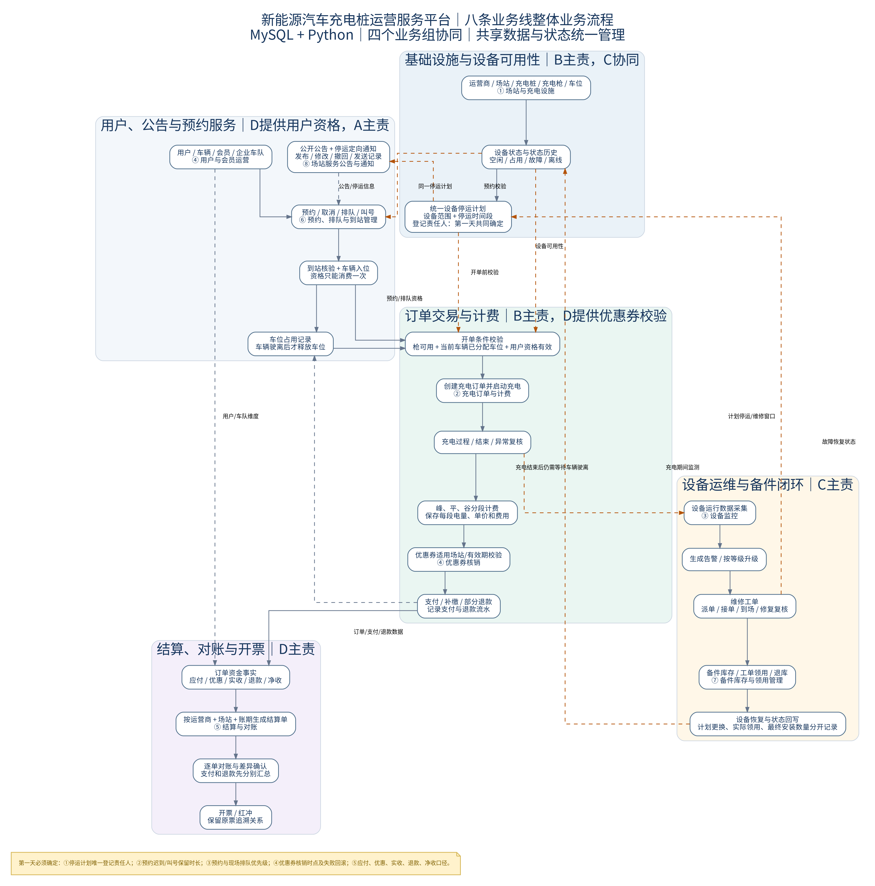

# 新能源汽车充电桩运营服务平台

> 《数据库系统》课程设计
>
> MySQL + Python｜4 名成员｜八条业务线

## 项目简介

随着新能源汽车保有量持续增长，“找桩—充电—支付”已成为高频刚需。一次充电背后涉及场站、充电桩、充电枪三级资产，峰平谷分时电价与服务费，以及设备状态、告警、工单、结算对账等一连串数据。运营方最怕三件事：桩显示空闲而实际故障、计费口径与账单对不上、故障响应慢导致用户流失。

本项目围绕“设备可用—用户充电—费用结算—故障处置”的运营闭环，设计并实现一个集场站设施、充电订单、设备监控、会员运营、结算对账于一体的充电桩运营服务平台数据库。在任务书原有 5 条业务线的基础上，小组新增 3 条业务线，共 **8 条业务线**，重点训练：

- 三级资产（场站—桩—枪）的外键与层级约束
- 按峰平谷时段分段的计费核价
- 告警到工单的状态流转闭环
- 平台与运营商之间的结算对账
- 预约排队、备件库存、公告通知等新增业务的跨模块协作

**当前阶段**：项目已进入关系模式、DDL、业务 SQL 与 Python 持久层实现阶段。B 的 16 张正式设施/订单表、D 的 9 张独立核心表与 3 张跨模块表、A 的 10 张预约排队/公告通知表均已在 MySQL 8.0.46 中完成建表与结构验收；D 核心测试数据、约束、查询和事务及 B–D 20 项集成检查均已通过，A 模块的测试数据、约束、查询和事务验证也已完成。Python 公共连接已统一使用 `+08:00` 会话时区，优惠券发放、锁定、释放和支付核销事务已实测，全仓 73 项单元测试通过。⑤结算与对账的 5 张表已在 MySQL 8.0.46 创建，S01～S10 结构验收全部通过，下一步准备测试数据。C 的 ③⑦ 数据字典与局部 E-R 图已提交，DDL 与持久层进度以 C 的最新分支为准。新增 ⑥⑦⑧ 三条业务线的视图/过程数量考核口径仍需向指导教师确认。

## 业务范围

| 编号 | 业务线 | 来源 | 负责人 | 核心内容 |
| --- | --- | --- | --- | --- |
| ① | 场站与充电设施 | 任务书 | B | 运营商、场站、充电桩、充电枪、车位档案；设备状态与状态历史 |
| ② | 充电订单与计费 | 任务书 | B | 开单、结束充电、峰平谷分段计费、支付、补缴、退款、异常复核 |
| ③ | 设备监控与故障工单 | 任务书 | C | 运行数据采集、告警生成与升级、派单、到场维修、修复复核 |
| ④ | 用户与会员运营 | 任务书 | D | 用户与车辆绑定、会员、优惠活动、优惠券发放核销、企业车队 |
| ⑤ | 结算与对账 | 任务书 | D | 运营商—场站—账期结算、逐单明细、对账差异、确认、开票与红冲 |
| ⑥ | 预约、排队与到站管理 | 小组新增 | A | 预约创建/取消/改约、现场排队、叫号、到站核验、车位占用与释放 |
| ⑦ | 备件库存与领用管理 | 小组新增 | C | 备件档案、分仓库存、入库、工单领用、退库、库存流水 |
| ⑧ | 场站服务公告与通知 | 小组新增 | A | 公开公告、停运定向通知、发布/修改/撤回、通知记录 |

八条业务线及跨模块交接关系见 [整体业务流程图](docs/新能源汽车充电桩平台_八条业务线整体业务流程图.png)：



## 团队分工

| 成员 | 业务组 | 负责业务线 | 重点交付 |
| --- | --- | --- | --- |
| A | 车主服务与信息发布 | ⑥ 预约、排队与到站管理；⑧ 场站服务公告与通知 | 预约/叫号/到站/车位释放；公告与定向通知 |
| B | 场站设施与交易实现 | ① 场站与充电设施；② 充电订单与计费 | 场站—桩—枪—车位模型；开单、分时计费、支付与退款 |
| C | 设备运维与备件管理 | ③ 设备监控与故障工单；⑦ 备件库存与领用管理 | 告警—维修闭环；库存、领用、退库与流水 |
| D | 会员运营与财务结算 | ④ 用户与会员运营；⑤ 结算与对账 | 用户、车辆、优惠与车队；结算、差异处理与开票 |

> 每位成员均参与数据库设计、SQL 实现与测试，并为负责业务线提供需求分析、数据字典、E-R 图、DDL、查询、视图、存储过程/触发器、持久层与测试证据。

## 技术栈与环境

| 项目 | 说明 |
| --- | --- |
| 数据库 | MySQL 8.0.46 / InnoDB / utf8mb4 |
| 开发语言 | Python 3.13（当前参考环境，建议 3.11+） |
| 持久层方案 | PyMySQL 1.2.4（已实现）+ SQLAlchemy 2.1.8（依赖已固定，按模块需要使用） |
| 依赖管理 | pip + `requirements.txt` |
| 版本管理 | Git + GitHub，一个公共仓库 |
| 设计工具 | E-R 图 / UML 类图（PowerDesigner、Visio、StarUML 等） |
| 数据字典 | Excel 主文件统一维护 |

统一约定：

- 表名、字段名使用英文小写 `snake_case`，如 `charging_order`、`parking_space_id`
- 金额字段使用 `DECIMAL` 等定点数类型，不使用 `FLOAT` / `DOUBLE` 直接存储金额
- 统一时间精度、时区和区间边界；计费时段明确起止边界
- 每个实体指定唯一主维护模块，其他模块通过统一编号与外键引用，不重复建表
- 公共编号：`station_id`、`pile_id`、`gun_id`、`parking_space_id`、`user_id`、`vehicle_id`、`reservation_id`、`queue_id`、`order_id`、`work_order_id`、`spare_part_id`、`settlement_id`

## 数据库设计要点

### 核心业务规则

- 场站、充电桩、充电枪构成三级层级，站对桩、桩对枪均为一对多；枪是订单与计费的最小对象，单枪最大功率不得超过所属桩的额定功率
- 同一把枪在同一时段只允许存在一笔进行中的订单（事务 + 锁/唯一约束保证并发安全）
- 电费按峰/平/谷分时电价分段累加，订单费用明细保存每段电量、单价与费用，新价格生效后历史账单仍可还原
- 支付记录与订单一对多，支持分次支付与补缴；退款需可追溯原支付流水
- 告警与工单一对多，同一告警允许多次派单并保留历史；工单闭环且设备复核通过后，告警方可恢复
- 优惠券核销与订单一一对应，不允许重复核销；支付失败、取消、退款时按约定释放或恢复
- 结算单按“运营商—场站—账期”唯一；差异明细必须回指具体订单，处理结论经双方确认后生效
- 支付与退款先分别按订单汇总，再关联结算明细，避免多笔支付/退款连接后金额重复累加
- 已确认账期后发生部分退款，在后续账期记录调整，并可追溯原订单与原结算单
- 开票金额不得超过结算单应结金额；红冲保留原票信息
- 库存数量更新与库存流水写入必须在同一事务中完成；两张工单争抢最后一件备件时只允许一笔成功
- 同一把枪的有效预约时间段不能重叠；预约/叫号资格只能消费一次，到站核验成功后才允许开单
- 充电结束但车辆未驶离时，车位仍保持占用，不提前释放或叫下一位
- 设备停运计划只能有一份共享数据源，预约校验、公告通知与开单校验读取同一份记录
- 手机号、车牌、税号等敏感字段脱敏展示、加密存储，并受 RBAC 与导出限制约束

### 核心表（初步）

> 以下为候选实体，最终表结构在 Day 2 结合关系基数、函数依赖与第三范式确定。

| 业务线 | 核心表（初步） |
| --- | --- |
| ① 场站与充电设施 | `operator`、`station`、`charging_pile`、`charging_gun`、`parking_space`、`equipment_status_log`、`equipment_outage_plan` |
| ② 充电订单与计费 | `charging_order`、`tariff_rule`、`order_fee_detail`、`payment_record`、`refund_record` |
| ③ 设备监控与故障工单 | `device_telemetry`、`alarm`、`maintenance_work_order` |
| ④ 用户与会员运营 | `membership_level`、`user`、`vehicle`、`membership_record`、`promotion`、`promotion_station`、`coupon`、`coupon_redemption`、`enterprise_customer`、`fleet`、`fleet_vehicle`、`fleet_quota_record` |
| ⑤ 结算与对账 | `settlement_statement`、`settlement_detail`、`reconciliation_difference`、`reconciliation_confirmation`、`invoice_record` |
| ⑥ 预约、排队与到站 | `charging_reservation`、`reservation_status_log`、`queue_record`、`queue_status_log`、`arrival_checkin`、`parking_occupancy` |
| ⑦ 备件库存与领用 | `spare_part`、`warehouse`、`inventory`、`inventory_transaction`、`work_order_part` |
| ⑧ 场站服务公告与通知 | `station_notice`、`notice_revision`、`notice_recipient`、`notification_record` |

## 三条端到端流程

1. **充电主流程**：预约/排队 → 到站核验 → 开单 → 分时计费 → 优惠券支付 → 结算对账
2. **运维闭环**：设备运行数据 → 故障告警 → 维修工单 → 备件领用/退库 → 修复复核 → 设备恢复
3. **停运通知**：计划停运 → 公告发布 → 通知受影响车主 → 预约取消/改约/换枪 → 恢复后再次通知

这三个场景是跨业务线联调与答辩演示的主线。

## 仓库结构

```text
.
├── A/               # A 模块说明、业务图、测试证据与字典生成工具
├── B/               # B 设施/订单数据字典、业务图与对接清单
├── app/             # Python 数据库连接、持久层、服务层和演示入口
├── docs/            # 数据字典、模块说明、任务分工、执行方案和业务流程图
├── sql/             # 各成员 DDL、测试数据、业务查询与验证脚本
├── target/          # 课程设计任务书与小组思路文档
├── tests/           # 持久层与事务单元测试
├── yX/              # C ③⑦ 数据字典与局部 E-R 图
├── requirements.txt # Python 依赖清单
└── README.md
```

## 文档索引

| 文档 | 说明 |
| --- | --- |
| [课程设计任务书](target/新能源汽车充电桩运营服务平台课程设计2026年任务书.pdf) | 学校下发的原始任务书，定义业务需求与验收要求 |
| [课设思路](target/DB课设思路_01.docx) | 五条原有业务线 + 三条新增业务线的方案与分工建议 |
| [八条业务线统一数据字典模板](docs/八条业务线统一数据字典模板_MySQL_Python.xlsx) | 数据字典、实体清单、关系清单、跨模块接口、业务规则（全组唯一来源） |
| [四人四天任务分工计划](docs/四人四天任务分工计划_八条业务线_MySQL_Python.docx) | 四天总览、逐日任务、验收清单与风险应对 |
| [第一天详细执行方案](docs/第一天详细执行方案_八条业务线_MySQL_Python.docx) | Day 1 时间安排、跨模块规则、公共编号与各成员任务 |
| [整体业务流程图](docs/新能源汽车充电桩平台_八条业务线整体业务流程图.png) | 八条业务线及跨模块交接关系 |
| [D 模块开发说明](docs/d/README.md) | ④用户会员、⑤结算对账的状态、交付物、运行方式和待确认接口 |
| [④业务线 DDL 说明](docs/d/04_membership.md) | ④核心表与跨模块表的设计说明、执行顺序和关键约束 |
| [⑤结算与对账设计说明](docs/d/05_settlement.md) | ⑤五表结构、金额与账期口径、状态流转、视图/过程及实施计划 |
| [⑤结算与对账建表前检查](sql/D/05_settlement_preflight.sql) | B 依赖、编号类型、引擎排序规则与目标表不存在性的只读检查 |
| [⑤结算与对账 DDL](sql/D/05_settlement_schema.sql) | 五张正式业务表、跨 B 外键、状态约束、生成列和索引 |
| [⑤结算与对账结构验收](sql/D/05_settlement_verify.sql) | 表、字段、约束、外键、类型、生成列和引擎的只读检查 |
| [A 模块开发说明](docs/a/README.md) | ⑥预约排队、⑧公告通知的状态、交付物、接口、运行方式和实测结果 |
| [⑥预约排队设计说明](docs/a/06_reservation_queue.md) | ⑥需求、E-R、3NF、DDL、并发控制、视图、查询与测试 |
| [⑧公告通知设计说明](docs/a/08_notice.md) | ⑧公告状态机、版本、接收人、通知状态机、视图与测试 |
| [A 数据字典](docs/a/A_06_08_data_dictionary.xlsx) | 10 表 116 字段，含类型、键、约束、索引与待确认事项 |
| [A 模块说明与导航](A/README.md) | A 的 SQL/Python/图表/测试证据索引与快速复现 |

## B 模块第二阶段交付

B 已新增 16 张正式表、124 个字段、7 个设施触发器及 6 个查询视图，订单用户和车辆已按 D 的真实结构建立外键。D 核心表 → B 结构 → D 跨模块表的建表及 20 项结构检查已在本地 MySQL 8.0.46 全部通过，测试事务已回滚。详情见 [B 开发与接入说明](B/README.md)。

[B 物理字典](B/第二天材料/B_第二天物理数据字典.xlsx)、[B 关系模式与范式说明](B/第二天材料/关系模式与设计说明.md)、[A/C/D 对接清单](B/第二天材料/ACD对接清单.md)和[验证记录](B/第二天材料/建表验证记录.md)可供继续汇总和联调。B 正式 Python 服务迁入及 A/C/D 业务事务联调为后续阶段。

## A 模块第三阶段交付

A 已完成 ⑥ 预约、排队与到站管理，以及 ⑧ 场站服务公告与通知：

- 新增 10 张表、116 个字段、34 个外键、40 个 CHECK、8 个视图、14 个存储过程、13 个触发器；
- 同枪预约使用“锁枪行 + 锁定读”保证并发安全，两个连接同时预约同一枪同一时段时仅一个成功；
- 到站核验触发器自动生成车位占用；生成列唯一约束保证同车位/同车辆最多一条未释放占用；
- 预约/排队资格只能消费一次，B 开单后调用 `sp_consume_admission` 原子消费；
- 公开公告、定向停运通知、公告版本、接收人快照、通知发送/失败/阅读状态机均已实现；
- 10 张表各至少 20 条测试数据；16 项约束测试、17 项真实数据库验收、61 项 Python 单元测试全部通过。

详情见 [A 模块开发说明](docs/a/README.md)、[A 模块说明与导航](A/README.md)、[⑥预约排队设计说明](docs/a/06_reservation_queue.md)、[⑧公告通知设计说明](docs/a/08_notice.md)和[A 本机实测记录](A/第三天材料/实测/README.md)。

> A 的 `sql/A/00_local_shared_fixtures.sql` 仅用于本地联调，提供 B 场站/枪/车位/停运计划的测试夹具；B 正式种子到位后应替换，不影响 A 的表结构和业务规则。

## 当前可验证成果

④用户与会员运营已完成可独立开发部分：

- 9 张核心表均已在 `charging_platform` 创建，使用 InnoDB 与 `utf8mb4_0900_ai_ci`
- 9 张核心表各提交 20 条虚构测试数据，共 180 条
- 主键、外键、唯一约束、CHECK 约束及 ID 类型检查全部通过
- 约束测试 T01～T08 全部 PASS，9 条核心业务查询结果符合预期
- Python 可连接 MySQL 8.0.46 并识别 9/9 张核心表
- 会员等级变更使用行锁和事务，同时更新当前等级与历史记录；真实数据库回滚演示 PASS
- 车辆加入/退出车队使用车辆行锁串行化并发请求；调车事务及回滚演示 PASS
- 优惠活动使用 `Decimal` 计算固定减免和百分比折扣；100 元订单最优活动实测优惠 24 元
- ④业务线已创建 3 个实用视图和 1 个只读优惠试算存储过程，数据库验收通过
- ④最终综合回归 F01～F08 全部 PASS，核心表、约束、业务一致性和敏感字段检查正常
- 3 张跨模块表已创建；3 个主键、7 个外键、4 个唯一约束和 5 个 CHECK 均通过 I01～I06 验收
- B 的 16 张表、7 个触发器、6 个视图及 D 的 12 张表已完成 20 项集成检查，全部 PASS 且测试数据已回滚
- Python 公共连接自动执行 `SET SESSION time_zone = '+08:00'`，真实连接返回 `+08:00`
- 优惠券发放、锁定、释放和支付核销使用行锁与同一事务；真实数据库完整链路及回滚均 PASS
- D 模块原有 Python 单元测试 23 项全部通过；加入 A 模块、连接时区和优惠券测试后全仓 73 项全部通过

快速验证：

```powershell
Copy-Item .env.example .env   # 首次运行时填写本机 MySQL 密码
.\.venv\Scripts\python.exe -m app.run_membership_demo
.\.venv\Scripts\python.exe -m app.run_membership_transaction_demo
.\.venv\Scripts\python.exe -m app.run_fleet_transaction_demo
.\.venv\Scripts\python.exe -m app.run_promotion_demo
.\.venv\Scripts\python.exe -m app.run_coupon_transaction_demo
.\.venv\Scripts\python.exe tests\verify_b_structure.py
.\.venv\Scripts\python.exe -m pytest -q
```

详细说明见 [D 模块开发说明](docs/d/README.md)。

A 模块当前可验证成果：

- 10 张表均已在 `charging_platform` 创建，使用 InnoDB 与 `utf8mb4_0900_ai_ci`
- 10 张表测试数据为 20/25/20/25/20/20/21/47/20/20 条，均 ≥20
- 34 个外键、40 个 CHECK、8 个视图、14 个存储过程、13 个触发器全部创建成功
- 16 项约束/状态机/过程测试全部 PASS，7 条业务查询执行成功
- 真实数据库验收 17 项全部 PASS：结构、数据、预约→核验→占位、定向公告→发送→撤回、同枪并发
- 同枪并发演示：两个连接同时预约同一时段，一个成功、一个 `RESERVATION_GUN_OVERLAP`，清理后 0 残留
- A 模块合入时全仓 Python 单元测试共 61 项，全部通过（含 A 的持久层、服务层与错误翻译测试）；加入公共连接时区和 D 优惠券事务测试后当前全仓为 73 项

A 快速验证：

```powershell
Copy-Item .env.example .env   # 首次运行时填写本机 MySQL 密码
.\.venv\Scripts\python.exe -m app.run_reservation_demo
.\.venv\Scripts\python.exe -m app.run_notice_demo
.\.venv\Scripts\python.exe -m app.run_reservation_workflow_demo
.\.venv\Scripts\python.exe -m app.run_notice_workflow_demo
.\.venv\Scripts\python.exe -m app.run_reservation_concurrency_demo
.\.venv\Scripts\python.exe -m pytest -q
.\.venv\Scripts\python.exe tests/verify_a_module.py
```

详细说明见 [A 模块开发说明](docs/a/README.md)。

## 开发计划

| 阶段 | 目标 | 主要产出 |
| --- | --- | --- |
| Day 1 | 需求分析与概念设计 | 整体流程图、八条业务线需求说明、统一数据字典、实体/关系清单、跨模块规则、全局 E-R 图初稿 |
| Day 2 | 逻辑结构与 MySQL 建表 | 关系模式、第三范式分析、统一字段类型与约束、全部可执行 DDL、成功创建的数据库 |
| Day 3 | Python 持久层与数据库功能 | DAO/CRUD、分页与批量写入、复杂 SQL、视图、存储过程/触发器、事务与并发测试、安全设计 |
| Day 4 | 联调、报告与答辩 | 三条端到端流程联调、执行计划与优化、备份恢复说明、小组报告、个人报告、PPT、5 分钟录像 |

## 验收指标

依据课程设计任务书：

- 每张表至少 **20 条测试数据**，外键引用有效
- 编写 **5 条连接 3 个及以上关系**的复杂 SQL，覆盖多表关联、聚合与条件筛选，查看执行计划并优化
- 原有 5 条业务线每条至少设计 **3 个实用视图**
- 原有 5 条业务线每条编写 **1 个存储过程或触发器**
- 完成 RBAC、密码加盐哈希、登录失败次数限制、会话超时、敏感字段脱敏/加密与 SQL 注入防护
- 设计数据备份与恢复策略（全量/增量备份周期、恢复目标、演练方式）
- 提交小组材料（任务书、代码、完整性机制文件、答辩 PPT 与录像）及个人材料

> 待确认：新增 ⑥⑦⑧ 三条业务线是否沿用原有 5 条线的视图、存储过程/触发器数量要求，需向指导教师确认后再定稿。

## 待确认事项

以下事项需组内讨论或向指导教师确认，确认后更新数据字典与本文档：

- C 模块的最终表结构、DDL 执行顺序及 A/B/D 跨模块联调时间；A/B 结构已接入并验证
- 新增三条业务线的考核口径（视图、存储过程/触发器数量）
- 设备停运计划的唯一登记责任人（B 或 C）
- 预约迟到保留时长、叫号保留时长、排队等待过期时长与现场排队优先级
- 预约提前核验窗口（当前最多提前 30 分钟）
- 公开公告是否需要主动推送，以及通知渠道优先级与重试策略
- 车位与充电枪的映射基数
- 优惠券已按“锁券时写订单优惠、支付失败时释放、支付成功后核销”实现；退款后是否返券及优惠规则快照仍需确认
- 应付、优惠、实收、退款、净收的金额口径及跨账期调整规则

## 协作规范

- 全组使用一个 Git 仓库，每天结束提交代码、图表与文档，保留提交记录和会议纪要
- 数据字典为字段定义的唯一来源；变更先更新字典，再改表结构和代码
- 每个实体只有一个主维护模块；跨模块通过统一编号、外键或约定接口引用
- 文档字段标注来源：任务书明确要求标“任务书”，小组设计标“小组补充”，未确认内容标“待讨论”
- 禁止抄袭；答辩时每位成员需能讲清自己负责的两条业务线、核心表、关键 SQL、约束/事务与测试结果

## 其他成员克隆与启动指南

> 面向首次加入项目的组员。以下命令均在仓库根目录执行；Windows 可使用 PowerShell 或 Git Bash，macOS / Linux 使用系统终端。

### 1. 前置环境

| 软件 | 要求 | 用途 |
| --- | --- | --- |
| Git | 任意较新版本 | 拉取代码与日常提交 |
| Python | 3.13（参考环境，建议 3.11+） | 运行持久层与测试 |
| MySQL | 8.0.46 | 本地数据库服务 |

### 2. 克隆仓库

已配置 GitHub SSH Key 时使用 SSH：

```bash
git clone git@github.com:kokozzzzzz/DataBase_Project2026.git
cd DataBase_Project2026
```

未配置 SSH 时改用 HTTPS：

```bash
git clone https://github.com/kokozzzzzz/DataBase_Project2026.git
cd DataBase_Project2026
```

### 3. 创建并激活虚拟环境

Windows PowerShell：

```powershell
python -m venv .venv
.\.venv\Scripts\Activate.ps1
```

若提示“禁止运行脚本”，仅对当前终端会话放行：

```powershell
Set-ExecutionPolicy -Scope Process -ExecutionPolicy Bypass
.\.venv\Scripts\Activate.ps1
```

Windows CMD：

```bat
python -m venv .venv
.venv\Scripts\activate.bat
```

Git Bash（Windows）：

```bash
python -m venv .venv
source .venv/Scripts/activate
```

macOS / Linux：

```bash
python3 -m venv .venv
source .venv/bin/activate
```

激活成功后，终端提示符前会出现 `(.venv)`。

### 4. 安装依赖

```bash
python -m pip install --upgrade pip
pip install -r requirements.txt
```

验证依赖可导入：

```bash
python -c "import sqlalchemy, pymysql, dotenv, pytest; print('dependencies ok')"
```

### 5. 配置数据库连接

1. 启动本地 MySQL，创建全组统一数据库：

   ```sql
   CREATE DATABASE charging_platform
     DEFAULT CHARACTER SET utf8mb4
     COLLATE utf8mb4_0900_ai_ci;
   ```

2. 在仓库根目录复制示例配置，并填写本机密码：

   ```powershell
   Copy-Item .env.example .env
   ```

   `.env` 内容如下：

   ```dotenv
   DB_HOST=127.0.0.1
   DB_PORT=3306
   DB_USER=root
   DB_PASSWORD=你的密码
   DB_NAME=charging_platform
   ```

3. `.env` 已被 `.gitignore` 忽略，**不要提交**，也不要把密码写进代码或文档。变量名由 `app/database/config.py` 统一读取。公共连接建立时会自动设置会话时区为 `+08:00`，不依赖 MySQL 服务器的 `SYSTEM` 默认时区。

### 6. 初始化数据库结构

④业务线可在 MySQL 客户端中按依赖顺序执行：

```sql
SOURCE sql/D/04_membership_core.sql;
SOURCE sql/D/04_membership_verify.sql;
SOURCE sql/D/04_membership_seed_core.sql;
-- 核对 9 张表均为 20 行后手动执行 COMMIT;
SOURCE sql/D/04_membership_constraint_tests.sql;
SOURCE sql/D/04_membership_business_queries.sql;
-- B 的 station、charging_order 创建完成后：
SOURCE sql/D/04_membership_integration.sql;
SOURCE sql/D/04_membership_integration_verify.sql;
```

`04_membership_integration.sql` 依赖 B 模块的 `station` 和 `charging_order`；当前已按 B 正式结构在 MySQL 8.0.46 验证通过。脚本不会删除或覆盖已有表，首次执行前应确认不存在同名表。

### 7. 设置 Git 身份并同步代码

首次克隆后设置提交身份：

```bash
git config user.name "你的姓名"
git config user.email "你的邮箱"
```

每天开始工作前拉取最新代码，结束前提交并推送：

```bash
git pull
# 开发与测试
git add .
git commit -m "feat: 完成 XXX"
git push
```

### 8. 完成检查

- [ ] 仓库克隆成功，`docs/`、`target/`、`requirements.txt` 均已拉取
- [ ] 虚拟环境已激活，终端提示符前有 `(.venv)`
- [ ] `pip install -r requirements.txt` 无报错
- [ ] `sqlalchemy`、`pymysql`、`dotenv`、`pytest` 均可正常导入
- [ ] 本地 MySQL 已启动，`.env` 已配置且未被 Git 跟踪
- [ ] `git config user.name` 与 `user.email` 已设置

> 依赖版本变更需全组确认后统一修改 `requirements.txt` 并提交，不要各自在本地升级；遇到环境报错先在群里同步完整错误信息。

```bash
#简化版流程（部分）
python -m venv .venv #创建venv虚拟环境
.\. venv\Scripts\Activate.ps1 #进入venv虚拟环境
pip install -r requirements.txt #下载requirements.txt中的依赖

如果你pip了其他依赖，请执行：
pip freeze > requirements.txt #将它们覆盖写入到 requirements.txt 文件中
```

```bash
#简化版github合作流程
git switch dev #切换至dev分支
git pull origin dev #拉取最新代码
git switch -c xxx(例如：koko) #创建并切换到你的新分支

……进行开发

git add . #添加修改
git commit -m "feat:完成xxx功能的具体描述" #提交
git push -u origin koko #推送到远程github

通过pull request合并分支到dev上，
写标题：例如 feat: 完成xxx功能。
写描述：简单写两句改了什么，怎么测试的。
选 Reviewer：选择你的队友或组长来审查代码。

合并完成后，页面上会出现一个 "Delete branch" 按钮，点它，删除github上这个功能分支，保持仓库干净。

回到你的电脑终端：
git switch dev
git pull origin dev

git branch -d koko #删除该功能分支

循环回第一步

```

