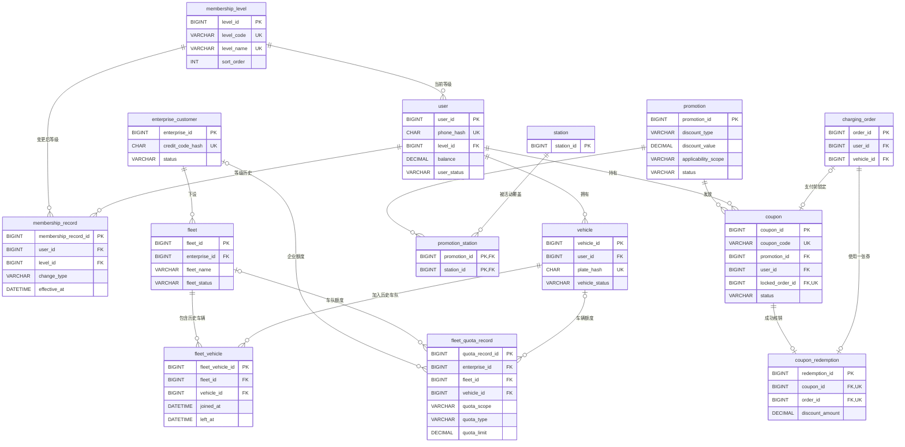
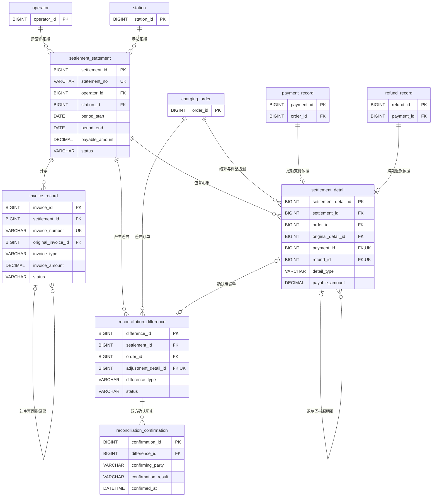

# D 模块局部 E-R 图

适用范围：④用户与会员运营、⑤结算与对账。`station`、`charging_order`、`payment_record`、`refund_record` 和 `operator` 为 B 模块实体，D 只通过正式外键引用，不修改其结构。

## ④ 用户与会员运营

`fleet_quota_record` 的三个目标外键不是同时生效。`quota_scope` 与 CHECK 约束保证每行只引用企业、车队或车辆中的一个目标。

## ⑤ 结算与对账

## 基数和历史保留说明

- 用户、车辆、企业、车队、活动等主数据采用逻辑状态，不物理删除历史引用。
- `fleet_vehicle` 保存加入和退出时间，同一车辆只能有一条未退出的有效关系。
- 一张券最多核销一次，一笔订单最多核销一张券；锁券与核销分别由唯一约束保证。
- 同一运营商、场站和半开账期只能生成一张结算单。
- 退款和差异调整不覆盖原结算明细，而是追加可回溯的新明细。
- 红字发票保留原普通发票，通过 `original_invoice_id` 形成自关联。
